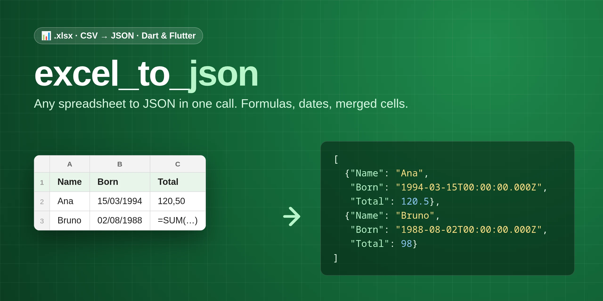

<p align="center">
  
</p>

<p align="center">
  <a href="https://pub.dev/packages/excel_to_json"></a>
  <a href="https://pub.dev/packages/excel_to_json/score"></a>
  <a href="https://pub.dev/packages/excel_to_json/score"></a>
  <a href="https://pub.dev/packages/excel_to_json/score"></a>
  <a href="https://github.com/vitoramaral10/excel_to_json/actions/workflows/test.yml"></a>
  <a href="LICENSE"></a>
</p>

<p align="center">
  <b>Turn any Excel or CSV spreadsheet into JSON with one call.</b><br>
  Formula results, dates, merged cells, title rows: handled. Pure Dart, every platform, plus a CLI.
</p>

<p align="center">
  🇧🇷 <i>Converta planilhas Excel (.xlsx) e CSV em JSON ou em mapas Dart, em Dart puro: resultado de fórmulas, datas, células mescladas, cabeçalho em qualquer linha.</i>
</p>

---

```dart
final json = const ExcelToJson().toJson(bytes);
```

```json
{"People": [{"Name": "Ana", "Age": 30, "Admin": true, "Total": 120.5},
            {"Name": "Bruno", "Age": 41, "Admin": false, "Total": 98}]}
```

## ✨ Features

|     | Feature | Details |
|-----|---------|---------|
| 📑 | **.xlsx and CSV** | Detected from the content; Excel, Google Sheets and LibreOffice files |
| 🧮 | **Formula results** | `=SUM(...)` gives the number Excel saved, not the formula text |
| 📅 | **Real dates** | Date-formatted cells come as dates, times as times, in any format |
| 🏷️ | **Header anywhere** | Skip title rows with `headerRow`, or use column letters with no header |
| 🔗 | **Merged cells** | Optionally repeat a merged value in every cell it covers |
| 🔑 | **Clean keys** | Trimmed, unique (`Name`, `Name_2`), or `snake_case` / `camelCase` |
| 🗂️ | **Pick sheets** | Convert every sheet or only the ones you name |
| 🖥️ | **Command line** | `excel-to-json report.xlsx > report.json` |
| 🌍 | **Pure Dart** | No plugins: Android, iOS, web, desktop, CLI and server |

## 🚀 Install

```bash
dart pub add excel_to_json      # or: flutter pub add excel_to_json
```

## 📖 Usage

The converter takes the bytes of an `.xlsx` or `.csv` file, wherever they come
from, and detects which one it is.

### From a file (CLI, server, desktop)

```dart
import 'dart:io';

import 'package:excel_to_json/excel_to_json.dart';

final bytes = File('people.xlsx').readAsBytesSync();
print(const ExcelToJson().toJson(bytes));
```

### Picked by the user in Flutter

With [`file_picker`](https://pub.dev/packages/file_picker) 13:

```dart
final file = await FilePicker.pickFile(
  type: FileType.custom,
  allowedExtensions: ['xlsx', 'csv'],
);
if (file == null) return; // cancelled

final json = const ExcelToJson().toJson(await file.readAsBytes());
```

### From an asset or a download

```dart
// Flutter asset
final data = await rootBundle.load('assets/people.xlsx');
final map = const ExcelToJson().toMap(data.buffer.asUint8List());

// HTTP
final response = await http.get(Uri.parse('https://example.com/people.xlsx'));
final rows = const ExcelToJson().toMap(response.bodyBytes)['People'];
```

### Without freezing a Flutter screen

A large spreadsheet takes a moment to convert. Run it off the UI thread with
`compute` from `package:flutter/foundation.dart`:

```dart
final map = await compute(const ExcelToJson().toMap, bytes);
```

### Map or JSON

`toMap` gives `Map<String, List<Map<String, Object?>>>`, sheet name to rows,
ready to feed your models. `toJson` gives the same shape as a string.

```dart
final sheets = const ExcelToJson().toMap(bytes);
for (final row in sheets['People']!) {
  print('${row['Name']} is ${row['Age']}');
}
```

## 🧾 Real-world spreadsheets

### A title above the header

Reports often start with a title and a blank line. Say which row has the
column names, numbered as Excel shows it:

```dart
const converter = ExcelToJson(config: ExcelToJsonConfig(headerRow: 3));
```

### No header at all

With `headerRow: null` every row is data and the keys are the column letters:

```dart
const converter = ExcelToJson(config: ExcelToJsonConfig(headerRow: null));
// [{"A": "Ana", "B": 30}, {"A": "Bruno", "B": 41}]
```

A column with data but no name in the header also gets its letter, so nothing
is lost.

### Merged cells

In the file, a merged cell holds its value only in its top-left cell. To repeat
it in every row and column it covers, as it looks on screen:

```dart
const converter = ExcelToJson(config: ExcelToJsonConfig(fillMergedCells: true));
// Region "South" merged over two rows:
// [{"Region": "South", "City": "Curitiba"}, {"Region": "South", "City": "Porto Alegre"}]
```

### Keys ready for code

```dart
const converter = ExcelToJson(
  config: ExcelToJsonConfig(keyStyle: KeyStyle.snakeCase),
);
// "Data de Nascimento" -> "data_de_nascimento", "Endereço (Rua)" -> "endereco_rua"
```

`KeyStyle.camelCase` gives `dataDeNascimento`. The default keeps the header
text, with extra spaces removed. Repeated names become `Name`, `Name_2`,
`Name_3`.

### Only some sheets

```dart
const converter = ExcelToJson(config: ExcelToJsonConfig(sheets: ['Sales']));
```

Naming a sheet the file does not have throws an `ExcelToJsonException` that
lists the sheets it does have. To keep every sheet but the hidden ones (often
lookup tables), set `includeHiddenSheets: false`.

## 🖥️ Command line

```bash
dart pub global activate excel_to_json

excel-to-json people.xlsx                         # JSON on stdout
excel-to-json report.xlsx --header-row 3 --keys snake --pretty > report.json
excel-to-json data.csv --sheet Sheet1 --empty-rows
```

`excel-to-json --help` lists every option; they mirror `ExcelToJsonConfig`
and also take the form `--option=value`. Exit codes: `64` bad usage, `65`
unreadable spreadsheet, `66` file not found, `74` output not written.

## 🔤 Cell values

| In the spreadsheet     | In `toMap`                                    | In `toJson`        |
|------------------------|-----------------------------------------------|--------------------|
| Text                   | `String`                                      | string             |
| Whole number           | `int`                                         | number             |
| Decimal, %, currency   | `double` (`5%` is `0.05`); `int` when whole   | number             |
| TRUE / FALSE           | `bool`                                        | boolean            |
| Date, date and time    | ISO 8601 `String` (or `DateTime`, see below)  | ISO 8601 string    |
| Time of day            | `HH:mm:ss` `String` (or `Duration`)           | `HH:mm:ss` string  |
| Elapsed time `[h]:mm`  | `HH:mm:ss`, hours can pass 24 (or `Duration`) | string             |
| Formula                | The result Excel saved                        | as its type        |
| Error (`#N/A`)         | The error text                                | string             |
| Empty cell             | `null`                                        | null               |
| Any CSV field          | `String`; empty field `null`, `""` is `''`    | string or null     |

CSV values stay text so codes like `01310100` keep their leading zero; convert
them in your model.

## ⚙️ All options

```dart
const converter = ExcelToJson(
  config: ExcelToJsonConfig(
    headerRow: 1,               // row with the column names; null for none
    sheets: null,               // only these sheets; null for all
    includeHiddenSheets: true,  // false: leave out sheets hidden in Excel
    keyStyle: KeyStyle.original, // or snakeCase, camelCase
    includeEmptyRows: false,    // keep rows with no values
    useDateTimeStrings: true,   // false: DateTime/Duration in toMap
    formulaResults: true,       // false: the formula text instead
    fillMergedCells: false,     // repeat merged values
  ),
);
```

`toJson` always writes dates as strings, since JSON has no date type.

Files written by tools that do not compute formulas (some libraries) have no
saved result; those cells give the formula text. With `formulaResults: false`,
a formula filled down a column gives its text only in the first cell: the
others store just a reference to it, so they give their result.

## 📄 CSV files

CSV is detected automatically and comes as one sheet named `Sheet1`. The
delimiter (`,`, `;` or tab) is the one used consistently on the first lines,
so files saved by Excel in Brazil, which use `;` and decimal commas, work as
they are, title line included. Quoted fields, line breaks inside quotes, a
UTF-8 BOM and Windows-1252 files (Excel's default on Windows) are handled.

## 🚨 Errors

Files that cannot be read throw `ExcelToJsonException`, with the original error
in `cause`: corrupt files, legacy `.xls` files (save them as `.xlsx`), and
sheets named in `sheets` that do not exist.

```dart
try {
  const ExcelToJson().toJson(bytes);
} on ExcelToJsonException catch (e) {
  print('Could not convert: ${e.message}');
}
```

## ⬆️ Migrating from 1.x

2.0 removes the built-in file picker, so the package is pure Dart and works
everywhere, with no native plugin or minimum iOS version imposed on your app.

| 1.x | 2.0 |
|-----|-----|
| `await ExcelToJson().convert()` (opened a picker, returned `String?`) | Pick the file yourself ([example](#picked-by-the-user-in-flutter)), then `ExcelToJson().toJson(bytes)` |
| `ExcelToJsonConfig(verbose: ...)` | Removed |
| `ExcelToJsonConfig(dateFormat: ...)` | Removed (it was never applied) |
| Formulas came as their text | They come as their result; `formulaResults: false` restores the text |
| Columns with a blank header were dropped | They keep their data under the column letter |

2.0 also fixes 1.x bugs: text cells crashed the conversion, a blank header
cell shifted the following columns, `useDateTimeStrings: false` crashed, and
empty rows were never skipped.

## ❓ FAQ

<details>
<summary><b>Does it read .xls or .ods?</b></summary>

No. `.xlsx` (Excel 2007 and later, also saved by Google Sheets and
LibreOffice) and CSV. Save older `.xls` and `.ods` files as `.xlsx`.
</details>

<details>
<summary><b>Does it read images, comments or colors?</b></summary>

No, only cell values: text, numbers, booleans, dates and formula results.
Images, comments, formatting and charts are left out.
</details>

<details>
<summary><b>How big a file can it handle?</b></summary>

Sheets are read as a stream of XML events, not loaded as a document tree: a
20,000-row, 10-column sheet converts in about 2 seconds on a laptop, using
tens of megabytes. The whole result is kept in memory, as a map.
</details>

<details>
<summary><b>Why is a formula cell showing the formula text?</b></summary>

The file has no saved result for it, which happens when it was written by a
tool that does not compute formulas. Open and save it in Excel, Google Sheets
or LibreOffice and the results are stored.
</details>

## 🤝 Contributing

Bug reports and pull requests are welcome; see
[CONTRIBUTING.md](CONTRIBUTING.md). A small `.xlsx` that shows the problem
helps the most. If the package helps you, ⭐ the
[repository](https://github.com/vitoramaral10/excel_to_json) and 👍 it on
[pub.dev](https://pub.dev/packages/excel_to_json).

## 📄 License

[MIT](LICENSE).
